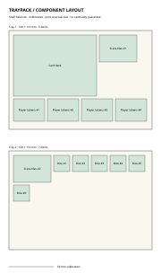

# Traypack

**Measure the pieces. Plan the trays.**

Traypack is a Rust command-line tool for planning rectangular board-game component
layouts. Give it card-deck footprints, token groups, and dice compartments; it
packs them into trays with configurable spacing, margins, and optional rotation,
then exports a labelled SVG at physical millimetre scale.

This is a new project with a working shelf-packing prototype. It has no external
Rust dependencies, accounts, telemetry, or network calls at runtime. It is a
layout planner, not a tray fabrication tool or an optimal bin-packing solver.



## Run

Install Rust and Cargo, then:

```bash
git clone https://github.com/sameerdeolalikar/traypack.git
cd traypack
cargo run -- examples/components.csv --width 160 --height 110 --output layout.svg
```

For an installed command, use `cargo install --path .`. No crates.io release is
claimed. The package declares Rust 1.74+; initial tests used Rust 1.99.1 on Linux.
Older toolchains and other operating systems still need verification.

## Component inventory

```csv
name,width_mm,height_mm,count,rotate
Card deck,68,93,1,yes
Player tokens,35,25,4,yes
Dice,18,18,6,no
Score tiles,42,30,2,yes
```

Names must be unique, at most 60 UTF-8 bytes, and contain no commas, quotes, or
control characters. This intentionally small CSV dialect does not support quoted
fields. Dimensions must be finite numbers from 0.1 to 10,000 mm, with 1–1,000 total
component instances. Input files are limited to 1 MB.

| Option | Meaning |
| --- | --- |
| `--width`, `--height` | Required total tray dimensions in mm |
| `--gap 3` | Minimum horizontal/vertical separation between components |
| `--margin 5` | Empty border on all sides of each tray |
| `--no-rotate` | Disable rotation even for rows marked `yes` |
| `--output layout.svg` | Destination; existing files are protected |
| `--force` | Explicitly replace an existing output file |

If any component cannot fit an empty tray, the command fails with exit code 2
before creating output. Components are never silently discarded or resized.

## How packing works

Items are sorted by longest side, area, and name for deterministic results. The
algorithm tries existing horizontal shelves, then creates a new shelf or tray.
It respects per-item rotation and leaves the requested spacing and borders.

This fast heuristic **does not guarantee the minimum number of trays**. Area
utilization is occupied component area divided by total tray area, including
margins. A low value can result from gaps, shape mismatch, or heuristic choices.
The bundled 13-instance example uses two trays with the default settings.

The SVG stacks all trays on one custom-sized sheet. Print at actual size and check
the 50 mm calibration line. There is no automatic A4/Letter pagination yet. SVG
labels for very small compartments may be omitted or reduced; full names remain
in SVG tooltips. Physical tray/print validation is still outstanding.

## Development

```bash
cargo test
cargo fmt --check
cargo clippy --all-targets -- -D warnings
```

The initial 10 integration tests cover quantity preservation, rotation, exact
fits, spacing and margin invariants over generated inventories, invalid inputs,
deterministic output, XML escaping, and CLI file protection.

For the initial environment, which lacked a C linker, tests used the self-contained
`x86_64-unknown-linux-musl` target with `RUSTFLAGS='-C linker=rust-lld'`. This is a
build-environment workaround, not a required setting on a normal Rust setup.

See [ROADMAP.md](ROADMAP.md) for future work and [CONTRIBUTING.md](CONTRIBUTING.md)
for conventions. GitHub Actions is not configured. Licensed under [MIT](LICENSE).
